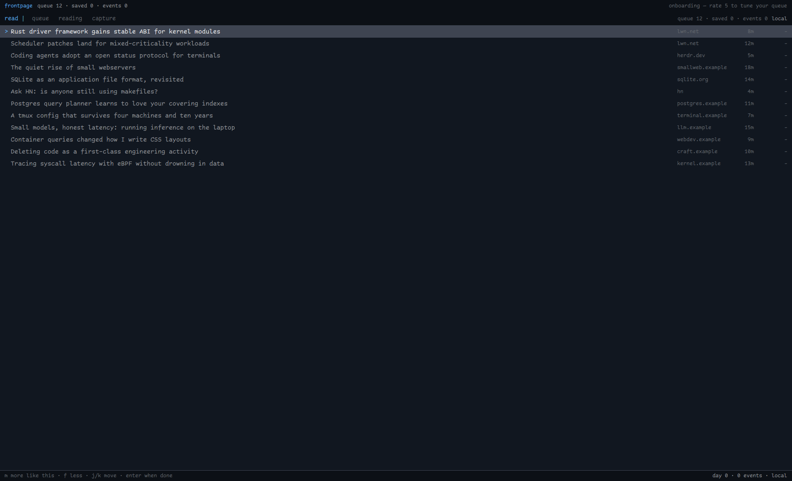

# frontpage

A Terminal-style personal reading queue that learns from feedback and explains
itself. You get a ranked queue of saved and subscribed stories; everything you
keep, skip, rate or mark nudges term and source weights, and every story can
show a plain-language "why" receipt for its score. Three pages (Queue /
Reading / Capture), local-only JSON storage, first-run onboarding that seeds 12
demo stories and asks for 5 ratings.

## What you see

Top to bottom, one column, `ink` theme, monospace-feeling 13px text on the
theme background:

1. **Status strip** (26px, chrome background): `frontpage` label in the theme
   accent (11px, semibold), then live counts from shared state —
   `queue N · saved N · events N` (11px, muted) — and on the right
   `onboarding — rate 5 to tune your queue` before onboarding, otherwise
   `local only · nothing leaves your machine` (11px, dim).
2. **Mod header** (30px, chrome, 1px bottom border): `read |` in accent 12px,
   then the page tabs `queue reading capture` (12px; the active page in the
   foreground color, the others dim; hover highlights). Right-aligned:
   `queue N · saved N · events N` (11px dim) and `local` / `agent on` (11px
   muted). During onboarding the tabs are inert.
3. **Flash line** (optional, 11px muted): transient messages like
   `· queue reordered from your ratings — press w on any story ·`.
4. **Page body**, one of:
   - **Queue**: one row per story — a 4px selection column (`>` when selected,
     row tinted `selected`), the title (truncated, muted; foreground when
     selected), the source (110px truncated, dim 11px), the read time
     (`8m`, 48px right-aligned, dim 11px), and the learned score (`-13.0` /
     `+0.8`, 64px right-aligned 11px; foreground when positive, dim when
     negative or zero, `-` before any feedback). Pressing `w` on a row adds an
     inline receipt under it: 11px muted, e.g.
     `why: kernel +0.8 (2 kept · 1 skipped) · lwn.net +0.4 · new +0.3`, or
     `why: no signal yet — rate a few stories and this will fill in`.
     Rows scroll (`overflow_y_scrollbar`) and the queue is capped at 30.
   - **Reading**: the story title (15px semibold) with `source · 8m` beside
     it, the extracted markdown body (scrollable, `TextView.markdown`), and a
     bottom line (11px muted, top border) that always shows that story's
     `why: …` receipt. Stories without stored text show
     `(no extracted text — open the url)`.
   - **Capture**: `add a story` with a URL input (rounded 7, 30px, input
     border, surface background) and a `fetch` button; the fetched result card
     (surface, rounded 7) shows title, `fetched via defuddle · N chars ·
     topic: kernel`, and `queue it` / `read now` buttons; then `add a source`
     with a feed-URL input and `subscribe`; then `your sources`, one row per
     source with `every 6h · kept N / skipped N` and an `x` remove button.
5. **Footer** (24px, chrome, 1px top border): the keymap for the current page
   (11px dim), right-aligned `day N · N events · local` (11px muted). During
   onboarding the left side reads
   `m more like this · f less · j/k move · enter when done`.

## How it behaves

- First run seeds 12 demo stories (no files of your own yet) and enters
  onboarding: `j`/`k` move, `m` = "more like this", `f` = "less like this";
  after 5 ratings `enter` finishes, unhides everything not rated, and flashes
  `queue reordered from your ratings — press w on any story`. The queue is
  re-ranked from the ratings.
- Queue keys: `j`/`k` move, `enter` opens the story, `x` dismisses, `S` saves
  for later, `m`/`f` rate +/-, `w` toggles the inline why-receipt, `v` toggles
  the saved filter, `u` undoes the last action, `c` goes to Capture.
- Reading keys: `h` marks read, `m`/`f` rate, `u` undo, `w` is a no-op there
  (the receipt is always visible), `a` toggles the agent pane, `q`/`escape`
  back to the queue, `n`/`x` dismiss and advance, `c` Capture.
- Capture: submit in the URL field (or `fetch`) runs
  `npx -y defuddle parse <url> --json --markdown` and falls back to a
  strip-tags fetch of the HTML; submit in the feed field (or `subscribe`)
  fetches the RSS/Atom XML, adds up to 5 entries as stories, and re-polls
  every 6h (15-minute check timer, up to 3 new items per source per poll,
  toast notification when new items arrive).
- Agent pane (`a`): picks the first installed agent, `pane.split` right with
  its run command, waits for the pane to appear, then `hc send`s
  `ask about this story: "<title>" (<url>)`. Pressing `a` again closes the
  pane. No agent installed → flash `no installed agent to open`.
- Learning: ledger events weigh the tokenized title+topic terms and the
  source. keep/mark +1, rate +2/-2, skip -1; an `undo` voids the event it
  undid. Term contribution is capped at ±1.5, source at ±1.0; stories younger
  than 14 days get up to +0.5 freshness. The receipt shows the top three
  parts with their kept/skipped counts.
- Every mod command is also scriptable: `frontpage.<key>` (from keys.json or
  `herdr-app do frontpage.m`) feeds the same key handler. Single characters
  pass through; these names are aliases: `more`→m, `less`→f, `why`→w,
  `open`/`d`→enter, `dismiss`→x, `save`→S, `saved`→v, `undo`→u, `capture`→c,
  `agent`→a, `mark`→h, `next`→n, `close`→q, `back`→escape, `up`→k, `down`→j.

## Built from

- `layouts/frontpage.json`: a `column` root, theme `ink`, with two blocks —
  `status` (26px, `mod: frontpage-status`) and `front` (fills the rest,
  `mod: frontpage`). No props on either mod.
- `mods/frontpage-status/` — one-file strip mod. Reads
  `shared("frontpage:counts")` (published by the main mod as
  `{queue, saved, events, onboarded}`) and renders it. Uses `theme`, `shared`,
  `div`, `h_flex`.
- `mods/frontpage/` — the app. `main.js` (View + pages + keys), `store.js`
  (JSON store), `rank.js` (weights + rank + why-receipts), `data/demo/demo.json`
  (12 demo stories with realistic titles/sources/read times).
  - herdr imports: `theme`, `exec`, `hc`, `run`, `panes`, `knownAgents`,
    `setShared`, `notify`, `nextCommand`. gpui-kit/gpui-base: `View`, `div`,
    `v_flex`, `h_flex`, `InputState`, `Input`, `TextView`
    (`TextView.markdown` for story bodies).
  - Commands run: `pane.split` / `pane.close` (agent pane), `hc` send (prefill),
    `exec("npx", ["-y", "defuddle", "parse", url, "--json", "--markdown"])`
    for capture. `fetch()` for feed XML and the defuddle fallback.
  - Storage lives under `mods/frontpage/data/`: `snapshot.json` (full state,
    rewritten on compaction) plus `ledger.jsonl` (append-only events, folded
    into the snapshot and truncated on compaction). Reads respect the 1 MiB
    `readTextFile` cap (story text trimmed to 20k chars per story, oldest
    read/dismissed text dropped first). Writes are fire-and-forget with a
    last-writer-wins retry so a stalled app file op never freezes the UI;
    `load()` reconciles snapshot + ledger on start. A missing/empty store
    seeds from `demo.json` for onboarding.
- No `keys.json` needed: keys are handled on the mod's focus handle. If you
  want chords, target `frontpage.<key>` commands as described above.

## Watch out

- The app's `readTextFile`/`writeTextFile` can stall for seconds (or hang) —
  that is why store writes never block and `load()` failure just flashes
  `store failed to load: …` with an empty queue; switching the layout away and
  back reloads the mod and retries.
- Mod commands must be single tokens; `herdr-app do frontpage.enter` is
  rejected — use `frontpage.d` (or the alias names above). `frontpage.p`
  writes a UI-structure dump to `mods/frontpage/data/debug-<n>.json`
  (rendered rows with score/selection/why-receipt, counts, page) for
  scripted verification.
- `nextCommand()` delivery is fire-and-forget: `herdr-app do` answers `ok`
  even when the mod is busy. Space commands ~1–2s apart when scripting.
- Capture needs `npx` on PATH and network access; the defuddle path is
  tried first and a crude strip-tags fetch is the fallback. Feed parsing is a
  regex over RSS/Atom XML (`<item>`/`<entry>`, `<title>`/`<link>`), 20 entries
  max, no OPML, no auth feeds.
- Story text is capped at 20k chars and dropped entirely (oldest first) if the
  snapshot would pass ~900 KB; those rows show
  `(text dropped to save space — open the url)`.
- The undo stack is in-memory only (last 20 actions) — an app restart clears
  it; the ledger keeps the history but undo after restart is not wired.
- Onboarding only triggers when stories exist but `onboarded` is false; if you
  delete your store, the demo seed comes back with it.

## Done when

- `herdr-app check mods/frontpage` and `herdr-app check mods/frontpage-status`
  both pass.
- `herdr-app do layout.switch --name frontpage` shows the strip, the queue and
  the footer with no entry in `herdr-app status` errors.
- On a fresh store: the queue lists the 12 demo stories with the onboarding
  footer; rating 5 stories (`m`/`f`) reorders the queue and the footer returns
  to the normal keymap.
- `w` on a story (or opening it) shows a `why:` line naming a weight, e.g.
  `why: agents +0.8 (1 kept) · herdr.dev +0.5 · new +0.4`.
- Capture: paste a public URL, `fetch` shows a result card via defuddle, and
  `queue it` puts the story in the queue with a detected topic.
